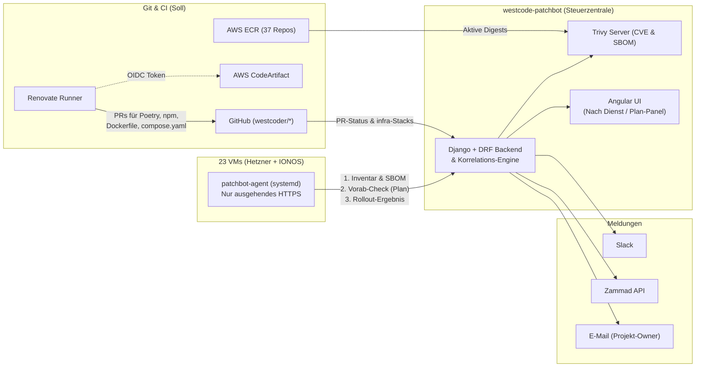

# Westcode Patchbot – Design-Spezifikation

**Datum:** 2026-11-03  
**Status:** Entwurf zur Freigabe  
**Repository:** `westcode-patchbot` (eigenständiges Werkzeug, getrennt von `westcode-hub`)

---

## 1. Kontext & Warum (Intent)

Westcode (~8 Personen) betreibt eine verteilte Infrastruktur, die in [`westcode-infra`](file:///Users/pietzschke/projects/westcode-infra/README.md) als OpenTofu-Code definiert ist:
- **22 langlebige Hetzner-Cloud-VMs** in 18 isolierten Projekten ([`docs/hetzner-projects.md`](file:///Users/pietzschke/projects/westcode-infra/docs/hetzner-projects.md)) sowie **1 IONOS-Cube-Server** ([`dev.westcode.de`](file:///Users/pietzschke/projects/westcode-infra/stacks/ionos-westcode/server.tf)) – auf einem Mix aus Debian 13, Ubuntu 26.04, 24.04, 22.04, drei EOL-Systemen auf `ubuntu-20.04` (`linklama`, `container-pool`, `wew-homepage`) und drei Bestands-VMs mit `image = null`.
- **37 AWS-ECR-Repositories** ([`stacks/aws-westcode/ecr.tf`](file:///Users/pietzschke/projects/westcode-infra/stacks/aws-westcode/ecr.tf)), gebaut über CircleCI (überwiegend Python/Poetry mit AWS CodeArtifact sowie Node/Angular).
- **Drei verschiedene Bereitstellungsarten auf den VMs:**
  1. **Eigene ECR-Applikationen** (z. B. [`westcode-hub`](file:///Users/pietzschke/projects/westcode-hub/deploy/hub-deploy.sh), [`ack-desk`](file:///Users/pietzschke/projects/ack-desk/deploy/docker-compose.yml)), die per CircleCI gebaut, auf dem Ziel-Host gepullt und teilweise lokal umgetaggt werden (`westcode-hub:<Commit>` → `hub-backend`).
  2. **Drittanbieter-Container in Git-verwalteten Compose-Dateien** (z. B. `postgres:18-alpine`, `maptiler/tileserver-gl-light`, `ghcr.io/valhalla/valhalla`, `traefik`), bei denen ein gemergter PR im GitHub-Repository noch nicht automatisch bedeutet, dass der Container auf allen Ziel-VMs neu ausgerollt wurde.
  3. **Host-lokale Installationen unter `/opt/...`** (z. B. Coder unter `/opt/coder` in lokaler Git-Versionskontrolle laut [`coder-hosting/README.md`](file:///Users/pietzschke/projects/westcode-infra/../coder-hosting/README.md) oder Dienste wie Plausible Analytics auf mehreren Hosts), die an keiner zentralen CI/CD-Pipeline hängen – plus die `apt`-Systempakete und Kernel der 23 VMs selbst.

Klassische Werkzeuge wie Dependabot sehen nur Git-Repositories, aber nicht, was tatsächlich auf den 23 Servern läuft. Reine Host-/CVE-Scanner liefern dagegen tausende ungefilterte Paket-Meldungen pro Server, ohne den Zusammenhang herzustellen: *„Für Plausible gibt es Version 2.1.2 (behebt CVE-…) – dafür muss 1 PR im Repo gemergt und das Image auf 3 Hosts ausgerollt werden.“*

`westcode-patchbot` schließt genau diese Lücke zwischen **Soll (Git & ECR)** und **Ist (laufende VMs)** in einer ruhigen, dienstzentrierten Steuerzentrale, aus der heraus Updates auch direkt angestoßen werden können.

---

## 2. Ziele, Nicht-Ziele & Anti-Ziele

### Ziele (Goals)
1. **Vollständiger Soll-/Ist-Index:** Erfassung aller 23 langlebigen VMs (abgeglichen gegen `westcode-infra`), ihrer `apt`-Pakete, OS-Lebenszyklen und Reboot-Anforderungen, aller laufenden Container (inkl. `RepoDigest`, OCI-Labels und `/opt/...`-Compose-Pfad), der aktiv genutzten ECR-Images sowie der Abhängigkeiten (`poetry.lock`, `package-lock.json`, `Dockerfile`, `compose.yaml`) in den GitHub-Repos.
2. **Komponenten-zentrierte Übersicht („Nach Dienst“):** Gruppierung von CVEs und verfügbaren Updates primär nach Dienst/Paket (z. B. *Plausible*, *Django*, *PostgreSQL*, *Coder*, *Ubuntu/Debian apt*) über alle Repos und Hosts hinweg statt isolierter Server-Listen.
3. **Automatische PR-Vorschläge:** Automatische Erstellung von Update-PRs in den `westcoder/*`-GitHub-Repositories (inkl. privater Python-Pakete aus AWS CodeArtifact).
4. **Direktes, sicheres Anstoßen von Updates:** Ausführung von Updates aus der Oberfläche heraus nach einem **2-stufigen Plan-Check (analog zu `tofu plan`)** und **seriellem Rollout mit Healthcheck & Auto-Rollback**, strikt getrennt nach Zuständigkeit (Git-PR/CircleCI vs. lokales `/opt`-Compose vs. `apt`).
5. **Gezielte Benachrichtigungen:** Anbindung an **Slack**, die **Zammad-API** (`support.westcode.de`) und **E-Mail** an einzelne Projekt-Verantwortliche.

### Nicht-Ziele (Non-Goals)
- **Keine Integration in den `westcode-hub`:** Der Patchbot ist bewusst ein separates Werkzeug mit eigener Oberfläche.
- **Kein Scannen kurzlebiger Build-VMs:** Ephemere Server im Projekt `westcode-tiles` (erkennbar am Label `role=tile-build`, [`docs/hetzner-projects.md`](file:///Users/pietzschke/projects/westcode-infra/docs/hetzner-projects.md#L66-L77)) werden ignoriert.
- **Kein Ersatz für OpenTofu:** Server-Erstellung, Firewalls und DNS bleiben zu 100 % in `westcode-infra`.
- **Kein Eigenbau einer CVE-Datenbank oder eines Dependency-Parsers:** Dafür werden Trivy und Renovate headless als Unterbau genutzt.

### Anti-Ziele (Was das System auch bei technischem Funktionieren zum Misserfolg machen würde)
- **Alert-Fatigue durch Grundrauschen:** Keine Meldungen für ungefixte Upstream-CVEs (`unfixed`), irrelevante Low-CVEs oder veraltete ECR-Image-Tags, die auf keinem einzigen Server mehr laufen (`keep_10`-Historie in [`ecr.tf`](file:///Users/pietzschke/projects/westcode-infra/stacks/aws-westcode/ecr.tf#L81-L98)).
- **Drift gegen Git erzeugen:** Der Patchbot darf niemals auf einer VM ein `compose.yaml` oder Container-Image direkt verändern, das eigentlich aus einem GitHub-Repository per CircleCI ausgerollt wird.
- **Verletzung der Kunden-VM-Isolation:** Kunden besitzen auf ihren VMs Root-Rechte ([`docs/ecr-access.md`](file:///Users/pietzschke/projects/westcode-infra/docs/ecr-access.md#L318-L321)). Eine kompromittierte Kunden-VM darf über den Patchbot-Agenten niemals Zugriff auf andere Server, fremde ECR-Repos oder zentrale Credentials erlangen.
- **Unruhige Oberfläche:** Kein Dashboard mit dutzenden bunten Badges, konkurrierenden Hauptknöpfen und verstreuter Aufmerksamkeit.

---

## 3. Rahmenbedingungen (Constraints)

1. **Netzwerk & Firewalls ([`modules/hcloud-firewall/baseline.yaml`](file:///Users/pietzschke/projects/westcode-infra/modules/hcloud-firewall/baseline.yaml)):** Alle Hetzner-Firewalls blockieren eingehenden Verkehr standardmäßig (außer CheckMK `178.104.33.61/32` auf Port `6556` und SSH aus `office` / `circleci_jobs`). Eingehendes SSH vom Patchbot auf alle Kunden-VMs würde Firewall-Regeln in 18 Stacks und zentrale Root-SSH-Keys erfordern. Deshalb arbeitet der Host-Agent **ausschließlich ausgehend (Pull per HTTPS)**.
2. **Lokales Image-Retagging ([`westcode-hub/deploy/hub-deploy.sh`](file:///Users/pietzschke/projects/westcode-hub/deploy/hub-deploy.sh#L31)):** Da Deploy-Skripte ECR-Images lokal umbenennen (z. B. `docker tag <ecr>/westcode-hub:<sha> hub-backend`), muss die Zuordnung zwischen laufendem Container, ECR-Image und GitHub-Commit über die **Image-ID / `RepoDigests` (`sha256:...`)** und OCI-Labels (`org.opencontainers.image.title`, `org.opencontainers.image.revision`) erfolgen.
3. **Design-System ([`westcode-hub/DESIGN.md`](file:///Users/pietzschke/projects/westcode-hub/DESIGN.md)):** Das UI folgt dem Westcode-Werkstattblatt-Prinzip: Weißer Grund (`#ffffff`), abgeschrägte Flächen in Neutral 50 (`#f5f5f7`, 45°-Ecke mit 12 px), Aeonik in den Schnitten 400 und 700, Tabellenziffern (`tabular-nums`) und **The One Voice Rule** (höchstens ein voller `Bluefly 400`-Hauptknopf im Sichtfeld).
4. **Secrets & Governance ([`westcode-infra/CLAUDE.md`](file:///Users/pietzschke/projects/westcode-infra/CLAUDE.md)):** Alle Secrets liegen in 1Password (`op://sn5aviuxthpjeoiu3c6yqwoij4/...`), AWS-Zugriff für CI/ECR/CodeArtifact läuft über OIDC-Rollen unter `/westcode-infra/` mit gesetzter Permissions Boundary.

---

## 4. Betrachtete Ansätze & Entscheidung

### Option 1: Open-Source-Engines (Trivy + Renovate) + eigene schlanke Steuerzentrale (`westcode-patchbot`) *(Gewählt)*
- **Aufbau:** **Renovate** übernimmt als geplanter Job die Git-Seite (Dependency-Updates & PRs inkl. CodeArtifact). **Trivy** übernimmt das CVE-Scanning von SBOMs und ECR-Images. **`westcode-patchbot`** ist die eigene Web-App + Agent-Steuerzentrale, die beide Datenströme mit dem Live-Zustand der 23 VMs zusammenführt, nach Dienst gruppiert und Rollouts steuert.
- **Vorteil:** Eine einzige, ruhige Oberfläche genau nach Westcode-Hierarchie; beantwortet die Plausible-Frage (Git-Orte + Host-Rollouts) in einer Zeile; respektiert das Sicherheitsmodell der Kunden-VMs; keine Lizenzkosten.
- **Trade-off:** Eigener Code für Korrelation, UI und den schlanken Host-Agenten.

### Option 2: Kombination fertiger Open-Source-Oberflächen (Renovate + Dependency-Track/DefectDojo + Komodo/Portainer + PatchMon) *(Verworfen)*
- **Trade-off:** Kein eigener UI-Code, aber verteilt den Alltag auf 3–4 unverbundene Tools. Keines davon verknüpft einen Renovate-PR in GitHub mit einem lokal umgetaggten Container oder drei `/opt`-Installationen auf Hetzner-VMs. Zentrale Container-Managementsysteme wie Portainer verletzen zudem das Trust-Modell für Kunden-VMs.

### Option 3: Kommerzielle SaaS-Plattform (z. B. Aikido Security) + eigenes Mini-Rollout-Tool *(Verworfen)*
- **Trade-off:** Gutes fertiges CVE-Filtering für Git und ECR, kostet aber ~4.500–6.000 €/Jahr und trennt trotzdem die Schwachstellen-Übersicht (im SaaS) vom realen Host-Zustand (`/opt`-Compose, `apt`, Rollout-Ausführung).

---

## 5. Architektur & Funktionsweise (Festgelegtes Design)

### 5.1 Datenquellen & Korrelations-Logik

1. **Soll-Bestand der Server (`westcode-infra`):**
   - Der Patchbot liest regelmäßig die `stacks/hetzner-*/servers.tf` und `stacks/ionos-westcode/server.tf` aus dem GitHub-Repo `westcoder/westcode-infra`.
   - Jede dort definierte VM (ohne `westcode-tiles`) gilt als Pflicht-Host. Fehlt von einem Pflicht-Host der Agent-Heartbeat (> 15 Minuten), erscheint dies als Infrastruktur-Warnung.

2. **Host-Agent (`patchbot-agent`):**
   - Ein einzelnes, statisch gebautes Binary (oder minimales Python-Skript ohne Dritt-Abhängigkeiten) als `systemd`-Service auf jeder der 23 VMs.
   - Authentifiziert sich per Host-spezifischem Bearer-Token (`op://` bei Provisionierung) ausschließlich für seinen eigenen Hostnamen.
   - **Inventar-Meldung (alle 15 Minuten sowie nach jedem Deployment/Upgrade):**
     - **OS & `apt`:** `/etc/os-release` (Erkennung von EOL-Releases wie Ubuntu 20.04), `uname -r`, `/var/run/reboot-required`, `needrestart -b`, Liste aller installierten `dpkg`-Pakete sowie `apt-get -s dist-upgrade` (ausstehende Updates, getrennt nach Security-Pocket und regulär).
     - **Laufende & gestoppte Container:** Auslesen über die lokale Docker-Engine-API (`/var/run/docker.sock`, nur lesend für den Inventar-Teil):
       - `Image`, `ImageID`, **`RepoDigests`** (`sha256:...`), Erstellungsdatum, Status/Health.
       - Compose-Metadaten aus den Container-Labels: `com.docker.compose.project`, `com.docker.compose.service`, `com.docker.compose.project.working_dir` (z. B. `/opt/hub`, `/opt/plausible`, `/opt/coder`) und `com.docker.compose.project.config_files`.
       - Für `/opt/...`-Verzeichnisse: Prüfung, ob dort ein lokales Git-Repository liegt (`git status --porcelain`, aktueller Branch/Commit) und welches Image-Tag in der `compose.yaml` eingetragen ist.

3. **Zentrales CVE- & Update-Matching:**
   - **Keine Last auf den VMs:** Der Agent führt keine schweren CVE-Scans auf Kunden-VMs aus. Er überträgt die Paketliste der VM und die Image-Digests an den Patchbot; dort prüft **Trivy** (im Server-Modus) die Paketlisten und scannt für laufende ECR-/Drittanbieter-Images einmalig pro Digest die SBOM (Syft/Trivy).
   - **Toten ECR-Ballast ausblenden:** Von den bis zu 10 Bildern pro ECR-Repository (`keep_10`) werden nur diejenigen gescannt und gemeldet, deren Digest **aktuell auf mindestens einer VM läuft** oder die dem neuesten Stand auf `main`/`develop` entsprechen.
   - **Noise-Filter (Standard):** CVEs ohne verfügbaren Upstream-Fix (`Status != fixed`) oder mit Schweregrad `LOW`/`UNKNOWN` werden in der Hauptansicht ausgeblendet (nur im Detail-SBOM-Export sichtbar).
   - **Dienst-Gruppierung:** Ein logischer „Dienst“ (z. B. *Plausible*, *Django*, *PostgreSQL*, *Coder*, *Ubuntu/Debian apt*) fasst alle Fundstellen zusammen:
     - Welche GitHub-Repos (`westcoder/*`) referenzieren dieses Paket/Image (inkl. offenem Renovate-PR und CI-Status)?
     - Auf welchen VMs läuft dieses Paket/Image aktuell in welcher Version?

### 5.2 Oberfläche & Visuelle Hierarchie (`Nach Dienst`)

Die Oberfläche folgt dem abgenommenen interaktiven Mockup (`dashboard-overview-v2.html`) und [`westcode-hub/DESIGN.md`](file:///Users/pietzschke/projects/westcode-hub/DESIGN.md):

1. **Kopfleiste (56 px):**
   - Links Westcode-Marke + `Patchbot`, mittig drei ruhige Reiter (**`Nach Dienst`**, **`Server (23)`**, **`Verlauf & Meldungen`**), rechts der Synchronisations-Status (`23 Hosts synchron · Letzter Lauf vor X Min.`).
2. **Zweispaltiges Arbeitsraster (Master-Detail):**
   - **Linke Hauptspalte (Dienst-Liste mit Logos):**
     - Unterteilt in zwei klare Dringlichkeits-Gruppen:
       1. **„Jetzt handeln · Sicherheits-Updates mit verfügbarem Fix“** (Kritische/Hohe CVEs mit Patch, EOL-Betriebssysteme).
       2. **„Bereit zum Ausrollen · Neue Versionen & Host-Updates“** (Neue Upstream-Releases, gemergte PRs, die noch nicht auf allen VMs laufen, reguläre `apt`-Updates/Reboots).
     - Jede Zeile besteht aus 4 ruhigen Elementen auf einer Linie (keine Buttons in der Liste!):
       1. **40×40 px Dienst-Logo** (Plausible, Django, PostgreSQL, Coder, Ubuntu/Debian, Traefik, Node/Angular etc.) zur sofortigen visuellen Orientierung.
       2. **Dienstname (fett)** + einzeilige Unterzeile (CVE-Kennung in `Salmon 700` oder Kurzbeschreibung der betroffenen Projekte).
       3. **Versionssprung** rechtsbündig in Tabellenziffern (`2.1.0 → 2.1.2`).
       4. **Betroffene Stellen** (`1 Repo · 3 Hosts` mit 8-px-Statuspunkt + Chevron `›`).
   - **Rechte Seitenspalte (Fokussiertes Plan-Panel mit 45°-Ecke):**
     - Zeigt für den links ausgewählten Dienst den bereits vom Agenten geprüften **Vorab-Plan (wie `tofu plan`)**:
       - **Block 1 – Git-Repository (Soll):** Betroffene GitHub-Repos, zugehöriger Renovate-PR und CI-Status (`CI grün · Bereit zum Merge`).
       - **Block 2 – Ausrollen auf N Hosts (Ist):** Liste der Ziel-VMs mit Pfad (`/opt/plausible/compose.yaml`), Vorab-Prüfung (`git clean`, freier Plattenplatz, Healthcheck-Endpunkt bekannt) und Versionswechsel (`2.1.0 → 2.1.2`).
     - **Einziger Hauptknopf auf der gesamten Seite (The One Voice Rule):**
       - `Plan ausführen (PR mergen & N Hosts nacheinander)` in `Bluefly 400`.
       - Darunter ein dezenter Sekundärknopf (`Als Aufgabe an Zammad übergeben`).

### 5.3 Sicherheitsstufen beim Ausrollen (Execution Engine)

Wenn ein Nutzer rechts auf **„Plan ausführen“** klickt, arbeitet der Patchbot je nach Eigentümerschaft der Stelle:

1. **Stellen im GitHub-Repository (mit CircleCI-Deploy):**
   - Der Patchbot merged über die GitHub-API den grünen Renovate-PR (bzw. triggert bei bereits gemergtem PR den CircleCI-Deploy-Workflow des Projekts) und überwacht, bis sich der Host-Agent nach dem CircleCI-Deploy mit dem neuen Image-Digest zurückmeldet.
2. **Host-lokale `/opt/...`-Compose-Installationen (ohne CI-Pipeline):**
   - **Stufe 1 (Vorab-Check / Plan):** Der Agent prüft vorab auf allen Ziel-Hosts, ob die Compose-Datei unter `/opt/...` existiert, ob ein lokales Git-Repo sauber ist (`git status --porcelain` leer) und ob das Ziel-Image in der Registry abrufbar ist. Liegen uncommittete manuelle Änderungen auf einem Host, blockiert der Plan für diesen Host mit einem klaren Hinweis.
   - **Stufe 2 (Serieller Canary-Rollout mit Auto-Rollback):**
     - Der Patchbot vergibt den Rollout-Job **zuerst nur an Host 1**.
     - Der Agent auf Host 1 merkt sich die aktuelle Image-ID (`PREV`), aktualisiert den Tag in `compose.yaml` (und erstellt bei lokalem `/opt`-Git wie in `/opt/coder` einen sauberen lokalen Commit `chore(patchbot): bump <service> to <version>`), führt `docker compose pull && docker compose up -d --remove-orphans` aus und prüft bis zu 60 Sekunden lang den Container-/HTTP-Healthcheck (analog zu [`westcode-hub/deploy/hub-deploy.sh`](file:///Users/pietzschke/projects/westcode-hub/deploy/hub-deploy.sh#L88-L98)).
     - **Bei Erfolg auf Host 1:** Host 2 und Host 3 werden nacheinander ausgerollt.
     - **Bei Fehlschlag auf Host 1:** Der Agent rollt Host 1 sofort auf `PREV` und den vorigen Git-Commit zurück (`docker compose up -d`), bricht den Rollout für Host 2 und 3 ab und erstellt automatisch ein Zammad-Ticket + Slack-Warnung mit den letzten 50 Zeilen `docker compose logs`.
3. **Systempakete (`apt`) & Reboots:**
   - Unkritische Debian/Ubuntu-Security-Updates werden über `unattended-upgrades` automatisch eingespielt.
   - Zurückgehaltene Pakete (`linux-image-*`, `openssl` etc.) oder ein ausstehender Reboot können über das Plan-Panel seriell Host für Host angestoßen werden (inkl. Healthcheck nach dem Reboot).

### 5.4 Benachrichtigungen (Slack, Zammad, E-Mail)

Um Alert-Fatigue im 8-köpfigen Team auszuschließen, unterscheidet das Routing drei Ereignistypen:
1. **Sofort-Alert (nur bei `Critical`/`High`-CVE mit verfügbarem Fix auf einem laufenden Dienst oder bei fehlgeschlagenem Rollout/Agent-Ausfall):**
   - Nachricht in **Slack** (mit direktem Link auf den Dienst-Plan im Patchbot) **und** automatische Anlage eines Tickets über die **Zammad-REST-API** (`support.westcode.de`, dedupliziert über CVE-/Service-Fingerprint, damit kein Ticket-Spam entsteht).
2. **Gezielte Owner-Benachrichtigung (E-Mail / Slack):**
   - Jedem Projekt/Host kann ein primärer Verantwortlicher zugeordnet werden; bei neuen freigabebereiten Plänen oder anstehenden Reboots für seine Systeme erhält dieser Nutzer eine direkte Mail bzw. Slack-DM.
3. **Wochen-Digest (Montagmorgen):**
   - Gebündelte Übersicht aller neuen nicht-kritischen Versionen, offenen Renovate-PRs und OS-Lifecycle-Warnungen per Slack und E-Mail.

---

## 6. Entscheidungen des Builders & Offene Spielräume (What's Left to the Builder)

Folgende technische Detailentscheidungen wurden bewusst als sinnvolle Defaults auf Basis des bestehenden Westcode-Stacks getroffen *(Builder's Call)*:

- **Tech-Stack der Steuerzentrale *(Builder's Call)*:** Django + Django REST Framework, PostgreSQL 18, Angular (analog zu [`westcode-hub`](file:///Users/pietzschke/projects/westcode-hub/PRODUCT.md)), bereitgestellt als Docker-Compose-Stack (z. B. unter `patch.westcode.de` auf `service.westcode.de` oder `monitor.westcode.de`), Anmeldung über den bestehenden Microsoft-365-Tenant (OIDC).
- **Sprache & Bauform des Host-Agenten *(Builder's Call)*:** Ein schlankes Python-3-Skript (nutzt ausschließlich die Python-Standardbibliothek auf Debian/Ubuntu ohne externe `pip`-Abhängigkeiten) als `systemd`-Service (`westcode-patchbot-agent.service`). So läuft es auf jedem Ubuntu-20.04- bis Debian-13-Server sofort ohne Kompilierungs- oder Dependency-Probleme.
- **Logo-Auflösung *(Builder's Call)*:** Kuratiertes Set lokaler SVG-Icons für die ~25 im Westcode-Bestand genutzten Technologien (Plausible, Django, Python, Angular, Node, PostgreSQL, Redis, Nginx, Traefik, Coder, Valhalla, TileServer, Ubuntu, Debian, Docker) mit automatischem Monogramm-Fallback im Westcode-Stil für unbekannte Pakete.
- **Job-Sicherheit zwischen Zentrale und Agent *(Builder's Call)*:** Der Agent akzeptiert keine beliebigen Shell-Befehle aus der API, sondern nur einen fest definierten Satz parametrisierter Aktionen (`compose_update`, `apt_upgrade`, `host_reboot`, `precheck`) und validiert Zielpfade strikt gegen eine lokale Allowlist (`/opt/*`).
