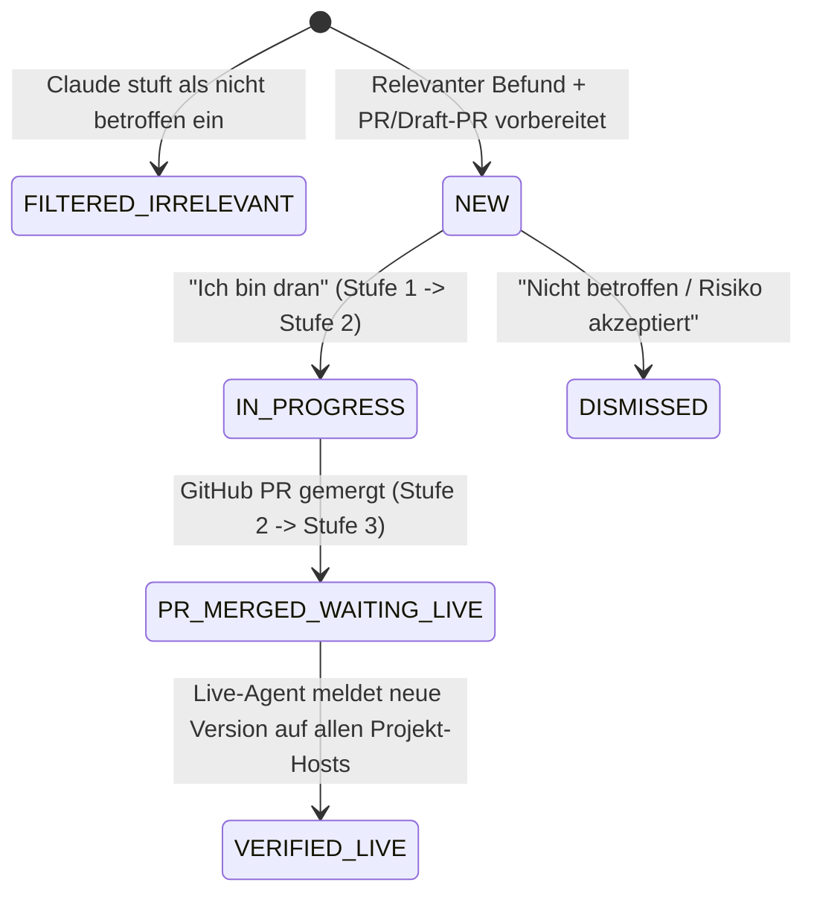

# Westcode Patchbot v2 — Security & Update Triage Control Plane (Design Specification)

**Date:** 2026-11-05  
**Status:** Draft (Pending Builder Check & User Approval)  
**Repository:** `https://github.com/pietzschke/westcode-patchbot`

---

## 1. Intent & Why

Westcode operates **17+ customer and internal projects** across **23 virtual machines** (defined as OpenTofu stacks in `westcode-infra`), **37 AWS ECR repositories**, and **30+ `westcoder/*` GitHub repositories**.

Our initial prototype (v1) focused on automated host rollouts and displayed raw scanner output. In practice, that created three problems:
1. **Live host mutation via SSH is undesirable:** Patchbot must never SSH into production VMs or mutate hosts directly. Humans (or existing CI pipelines after PR merge) perform the actual patching.
2. **Raw scanner output causes alert fatigue:** An unfiltered Trivy scan across local repositories yields ~2,000 raw CVEs, making it impossible to see on arrival whether urgent action is actually needed today.
3. **Missing project & ownership context:** A security finding or update is only actionable if the system knows **which project** it belongs to (linking Notion projects, GitHub repos, containers, and hosts), **how complex the fix is** (*Einfacher Fix* vs. *Komplexer Eingriff*), **which developer in the team knows that code best**, and **whether a merged fix is actually running live on the server**.

**Westcode Patchbot v2** is an intelligent **Security & Update Triage Control Plane** that:
- Continuously links **Notion Projects ↔ GitHub Repositories ↔ Docker/ECR Containers ↔ Live Hosts** inside Patchbot.
- Runs a **daily research & vulnerability scan** combined with a **Claude AI Triage & Code-Patching Engine** that checks code reachability, reads changelogs for breaking changes, filters out unexploitable noise, classifies findings into **Einfache Fixes (Quick Wins)** vs. **Komplexe Eingriffe (Deep Dives)**, and automatically prepares either a **ready Fix-PR** or a **Draft-PR with application code patches** on GitHub.
- Matches the best responsible person (Infrastructure team for OS/host layers; the most recent Git author on the affected files for application layers, falling back to the Notion project owner) and notifies them via **personal Slack DM**.
- Enforces **3-stage Grace Periods** (`24h Sichtung` → `48h Einfacher Fix / 7d Komplexer Eingriff` → `24h Live-Gang nach PR-Merge`), escalating to the shared Team Slack channel if a stage expires, and **only marks a finding as resolved once the read-only host agent confirms the fix is running live on the VM**.

---

## 2. Goals, Non-Goals, and Anti-Goals

### Goals
1. **1-Second Dashboard Clarity (Status-Ampel):** Opening the dashboard immediately answers whether urgent action is required today (**Rot**), everything open is actively being worked on within its grace period (**Gelb**), or the fleet is clean (**Grün**).
2. **Project-Centric Asset Graph in Patchbot:** Sync projects and project leads from Westcode's **Notion database** and link them inside Patchbot to **GitHub repositories**, **containers**, and **hosts** (e.g., bundling `mdb.westcode.de`, `converter.westcode.de`, `westcoder/materialdatenbank`, and `westcoder/wuerth-converter` under **Würth**), with an **"Unzugeordnete Assets" inbox** and auto-match suggestions so nothing falls through the cracks.
3. **Read-Only Live Host Telemetry:** Each VM reports its live OS version, kernel/reboot flag, upgradable `apt` packages, and running container image digests via a strictly read-only outbound push agent (`POST /api/agent/report`).
4. **Daily Research & Claude AI Triage + Auto-PRs:**
   - Scan CVE/Advisory databases (OSV.dev, GitHub Advisory Database, Trivy, Ubuntu/Debian Security Notices) and upstream releases once daily (plus on demand).
   - Use **Claude (Anthropic API)** to inspect the repository code and changelogs: filter out unexploitable/dev-only noise and split actionable findings into **Einfache Fixes** vs. **Komplexe Eingriffe**.
   - Automatically open a **Fix-PR** (for simple updates) or a **Draft-PR where Claude also attempts to patch the affected application code** (for complex upgrades with breaking changes) before notifying the developer.
5. **Context-Aware Ownership & 3-Stage Grace Periods with Slack Bot:**
   - Route OS/Infrastructure findings to the designated Infrastructure owners; route Application/Repo findings to the developer who most recently touched the affected files in Git (fallback: Notion project owner).
   - Send a personal **Slack DM** with interactive action buttons (*„Ich bin dran“*, *„Nicht betroffen“*).
   - Track three sequential grace periods (`24h Sichtung` → `48h/7d Umsetzung` → `24h Live-Verifikation nach Merge`) and escalate overdue items to the Team Slack channel.
   - Resolve a finding (`VERIFIED_LIVE`) **only** when the live host telemetry confirms the patched version is running in production.

### Non-Goals
- Replacing CircleCI or OpenTofu (`westcode-infra`).
- Full SIEM / runtime intrusion detection (log shipping, packet inspection).
- Editing the Notion database from within Patchbot (Notion is read-only source for projects and project owners; asset linking happens inside Patchbot).

### Anti-Goals (Must Never Happen)
- **No SSH from Patchbot & No Live Host Patching:** Patchbot must never open SSH connections to hosts or execute mutating commands (`apt upgrade`, `docker compose up`, file edits) on production VMs.
- **No Raw CVE Dump / Alert Fatigue:** Never send Slack DMs for unverified raw scanner rows or dev-only transitive vulnerabilities that Claude determined are unreachable.
- **No "Premature Done" on PR Merge:** A merged PR in GitHub must never close a finding while the production VM still runs the vulnerable container or package.

---

## 3. Constraints & Technical Decisions

- **Technology Stack:**
  - **Backend:** Python 3.12+, Django 5.2, Django REST Framework (`backend/`).
  - **Frontend:** Angular 22 standalone components with Signals, custom Westcode styling (`frontend/`).
  - **Host Telemetry Agent:** Python 3.8+ standard-library-only script (`agent/patchbot_agent.py`), invoked by a read-only `systemd` timer (`ProtectSystem=strict`).
  - **AI Engine:** Anthropic Python SDK (`anthropic`) using Claude (`claude-sonnet-4-6` by default, configurable via `PATCHBOT_CLAUDE_MODEL`).
  - **Integrations:**
    - **Notion API (`2022-06-28`):** Read-only sync of the Westcode Projects database (`NOTION_API_KEY`, `NOTION_PROJECTS_DATABASE_ID`).
    - **GitHub (`gh` CLI / REST & GraphQL API):** Repo cloning/worktrees, PR/Draft-PR creation, CI status checks, `git log` / `git blame` ownership analysis (`GITHUB_TOKEN`).
    - **Slack API (`SLACK_BOT_TOKEN`, `SLACK_APP_TOKEN`, `SLACK_TEAM_CHANNEL_ID`):** User lookup by `@westcode.de` email (`users.lookupByEmail`), direct messages (`chat.postMessage`), and interactive button callbacks (`Ich bin dran`, `Nicht betroffen`).

---

## 4. Architectural Approaches Considered

### Approach A (Selected): Integrated Django Control Plane with Local Git Worktree Claude Runner & Built-in Scheduler
A single modular Django service (`inventory`, `research`, `triage`, `slackbot`) running scheduled jobs via an integrated scheduler / management commands (`run_daily_scan`, `check_grace_periods`) and using a local repository cache (`/var/lib/patchbot/repos/`) with ephemeral `git worktree` checkouts for Claude analysis and PR creation.
- **Pros:** Single deployment unit, zero Redis/Celery operational overhead, central access to Notion + all 30+ GitHub repos + live VM inventory in one database.
- **Cons:** Requires ~2–5 GB persistent volume for the local Git repository cache.

### Approach B (Rejected): Distributed GitHub Actions per Repository
Running the CVE scan and Claude code patcher inside each of the 30+ `westcoder/*` repositories via GitHub Actions.
- **Why rejected:** Requires maintaining workflow files and secrets across 30+ repos and lacks awareness of Notion projects and live VM state.

### Approach C (Rejected): Multi-Service Celery + Redis + Separate Microservices
- **Why rejected:** Unnecessary operational complexity for 23 VMs, 17 projects, and a once-daily research scan.

---

## 5. System Architecture & Data Model

### 5.1 Domain 1: `inventory` (Project Graph, Assets & Team Directory)

#### `TeamMember`
Maps a human across Notion, GitHub, and Slack:
- `id`: UUID / AutoField
- `name`: `str` (e.g., `"Moritz Pietzschke"`)
- `email`: `str` (unique, `@westcode.de` address — used for automatic matching against Notion person fields and Slack `users.lookupByEmail`)
- `github_username`: `str` (unique, e.g., `"pietzschke"` — required because GitHub accounts do not expose `@westcode.de` emails)
- `git_commit_emails`: `JSONField[list[str]]` (optional additional git author email aliases)
- `slack_user_id`: `str` (e.g., `"U01234567"`, auto-populated via Slack API from `email`, editable)
- `layers`: `JSONField[list[str]]` (subset of `["infrastructure", "application"]`)
- `is_default_infra_owner`: `bool` (marks primary recipients for OS/Infrastructure layer findings)
- `is_active`: `bool`

#### `Project`
Synced from the Notion database (or created locally before Notion is configured) and enriched in Patchbot:
- `id`: UUID / AutoField
- `slug`: `str` (unique, e.g., `"wuerth"`, `"ses-sandmann"`, `"westcode-service"`)
- `name`: `str` (e.g., `"Würth"`)
- `notion_page_id`: `str | None` (unique when present)
- `notion_url`: `str`
- `customer_name`: `str`
- `owner`: `ForeignKey(TeamMember, null=True, on_delete=SET_NULL)` (resolved from Notion's responsible person property via `@westcode.de` email)
- `logo_key`: `str` (default `"westcode"`)
- `last_notion_synced_at`: `DateTimeField | None`

#### Assets Linked to a `Project` in Patchbot
1. **`RepositoryAsset` (`westcoder/*` GitHub repository):**
   - `full_name`: `str` (unique, e.g., `"westcoder/materialdatenbank"`, `"westcoder/wuerth-converter"`)
   - `default_branch`: `str` (default `"main"`)
   - `project`: `ForeignKey(Project, null=True, blank=True, related_name="repositories")`
   - `suggested_project`: `ForeignKey(Project, null=True, blank=True, related_name="suggested_repositories")`
   - `last_scanned_at`: `DateTimeField | None`
   - `last_commit_sha`: `str`
2. **`Host` (VM from `westcode-infra` + live telemetry):**
   - `slug`: `str` (unique, e.g., `"mdb-westcode-de"`)
   - `hostname`: `str` (unique, e.g., `"mdb.westcode.de"`)
   - `provider`: `str` (`"hetzner"` | `"ionos"`)
   - `stack_name`: `str` (from `westcode-infra`, e.g., `"hetzner-wuerth"`)
   - `project`: `ForeignKey(Project, null=True, blank=True, related_name="hosts")`
   - `suggested_project`: `ForeignKey(Project, null=True, blank=True, related_name="suggested_hosts")`
   - `declared_image`: `str | None`
   - `os_distro`, `os_version`, `kernel_version`: `str`
   - `is_os_eol`: `bool`
   - `reboot_required`: `bool`
   - `agent_token_hash`: `str`
   - `last_seen_at`: `DateTimeField | None`
3. **`HostContainer` (Running container reported by host agent):**
   - `host`: `ForeignKey(Host, related_name="containers")`
   - `container_id`, `name`, `image_tag`, `image_id`: `str`
   - `repo_digests`: `JSONField[list[str]]`
   - `working_dir`, `compose_service`: `str`
   - `git_clean`: `bool | None`
   - `project`: `ForeignKey(Project, null=True, blank=True, related_name="containers")` (inherits from `host.project` or mapped `repository.project` unless overridden)
   - `repository`: `ForeignKey(RepositoryAsset, null=True, blank=True, related_name="running_containers")` (auto-matched via ECR repo name / compose service / image name)
4. **`HostPackage` (Upgradable `apt` package reported by host agent):**
   - `host`: `ForeignKey(Host, related_name="packages")`
   - `name`, `installed_version`, `candidate_version`: `str`
   - `is_security_update`: `bool`

#### Auto-Discovery & "Unzugeordnete Assets" Inbox
Whenever Notion sync, GitHub repo discovery, `westcode-infra` sync, or a live host report runs:
- Any `RepositoryAsset`, `Host`, or `HostContainer` with `project_id is None` is scored against existing `Project` records (using token overlap between `Project.slug`/`Project.name`, `Host.stack_name`, `RepositoryAsset.full_name`, and ECR repository names) to populate `suggested_project`.
- Unmapped assets appear in the **„Unzugeordnete Assets“-Inbox** in the UI, where a user can confirm a suggestion with one click or pick a project from a dropdown.

---

### 5.2 Domain 2: `research` (Daily CVE Scanner, Claude Triage & Auto-PR Engine)

#### Daily Scan Pipeline (`python manage.py run_daily_scan` / `POST /api/scans/run/`)
Runs automatically once per day (default `07:00 Europe/Berlin`) and can be triggered manually from the UI:
1. **Refresh Inventory:** Sync Notion projects, sync `westcode-infra` stacks, fetch open PRs across `westcoder/*`, and `git fetch` active `RepositoryAsset` clones in the local repo cache.
2. **Collect Raw Vulnerability & Upgrade Candidates:**
   - **Application / Repo Layer:** Run `trivy fs --scanners vuln --severity MEDIUM,HIGH,CRITICAL --format json` (and OSV/GitHub Advisory lookup) against each `RepositoryAsset`. Group raw CVEs by `(repository, ecosystem, package_name, fixed_version)` into a single candidate upgrade cluster (e.g., all CVEs fixed by upgrading `django` from `5.2.1` to `5.2.9` form one candidate).
   - **Infrastructure / OS Layer:** Group security `HostPackage` entries (`is_security_update=True`), `reboot_required=True`, and `is_os_eol=True` per `Host`.
3. **Claude AI Triage & Reachability Analysis:**
   For each new or changed candidate cluster:
   - Extract context from the repository:
     - Dependency manifest (`pyproject.toml`, `package.json`, `Dockerfile`, `compose.yaml`) showing whether the dependency is in `dependencies` (production) or `devDependencies`/`[dependency-groups.dev]`.
     - Up to 15 code snippets (`grep` / AST search) where the package or affected module is imported and called in the repository.
     - Upstream changelog / release notes and CVE advisory descriptions.
   - Prompt **Claude (`claude-sonnet-4-6`)** with a strict JSON schema to evaluate:
     - `is_relevant` (`bool`): Is this vulnerability reachable or relevant in production? (If `False` — e.g. dev-only linter dependency or unused feature — the candidate is stored with status `FILTERED_IRRELEVANT` so it produces **zero** dashboard alarms and **zero** Slack DMs).
     - `complexity` (`"SIMPLE"` | `"COMPLEX"`):
       - `"SIMPLE"`: Drop-in patch/minor update or `apt` security update with no breaking changes in the repository's call sites.
       - `"COMPLEX"`: Breaking API changes affecting files in the repository, major framework/database upgrade, or Ubuntu EOL migration.
     - `severity` (`"CRITICAL"` | `"HIGH"` | `"MEDIUM"`).
     - `title_de`: Concise German headline (e.g., *"SQL-Injection in Django QuerySet.values() (CVE-2026-xxxx)"*).
     - `summary_de`: 2–3 sentences explaining *why* this affects the project and what the update changes.
     - `affected_files`: `list[{"path": str, "line": int, "explanation": str}]` pointing to the exact files in the repository.
     - `breaking_changes_de`: Summary of breaking changes and required code adjustments (empty for `"SIMPLE"`).
4. **Automated GitHub PR / Draft-PR Preparation:**
   For relevant (`is_relevant=True`) repository findings:
   - First check if an open Dependabot/Renovate/team PR already targets `(repository, package_name, target_version)`. If so, attach that PR (`pr_number`, `pr_url`).
   - If no PR exists yet:
     - Create a temporary `git worktree` on branch `patchbot/<package>-<target_version>`.
     - **If `complexity == "SIMPLE"`:** Update the version constraint/lockfile, commit, push, and open a **ready Pull Request** (`gh pr create`) containing Claude's German triage report.
     - **If `complexity == "COMPLEX"`:** Invoke Claude's code-patching tool loop on the worktree (bounded strictly to files inside the worktree): update the dependency manifest **and** apply the necessary code changes in `affected_files`, commit, push, and open a **Draft Pull Request** (`gh pr create --draft`) explaining what Claude patched and which files the developer should review while CircleCI runs.

---

### 5.3 Domain 3: `triage` (Ownership Matching, Lifecycle & 3-Stage Grace Periods)

#### Ownership Matching Cascade
When a `TriageFinding` is created:
1. **If `layer == "INFRASTRUCTURE"`** (OS `apt` security updates, kernel reboots, Ubuntu EOL, or host-only containers without a Westcode app repo):
   - Assign to the active `TeamMember` marked `is_default_infra_owner=True` (or the first active member with `"infrastructure"` in `layers`).
   - `matched_reason_de`: *"Zuständigkeit Schicht: Infrastruktur & Betriebssystem"*.
2. **If `layer == "APPLICATION"`**:
   - **Step 1 (Git Blame / Recent Author):** Inspect `git log -n 20 --format="%an <%ae>"` on the `affected_files` (or dependency manifest) in `RepositoryAsset`, ignoring bots (`dependabot`, `renovate`, `github-actions`). Match the most recent human commit against `TeamMember.github_username` (via GitHub API commit author login) or `TeamMember.email` / `TeamMember.git_commit_emails`.
   - **Step 2 (Notion Project Owner Fallback):** If no active `TeamMember` is matched from Git history, assign to `project.owner` (from Notion).
   - **Step 3 (Global Fallback):** Assign to the default application/infra lead.
   - `matched_reason_de`: e.g., *"Zuletzt an `backend/pyproject.toml` gearbeitet (Commit `a4f91c2`)"* or *"Projektverantwortung laut Notion"*.

#### `TriageFinding` State Machine & 3-Stage Grace Periods

| Stage | Status | Grace Period | What Stops / Advances the Clock | What Happens on Expiry |
| :--- | :--- | :--- | :--- | :--- |
| **Stage 1: Sichtung** | `NEW` | **24 Hours** from `created_at` | Assignee clicks **„Ich bin dran“** (moves to `IN_PROGRESS`) or **„Nicht betroffen“** (`DISMISSED`). | Marks `is_escalated = True` (`escalation_stage = 1`) and posts **Sichtungs-Eskalation** to the Team Slack channel. |
| **Stage 2: Umsetzung** | `IN_PROGRESS` | **48 Hours** (`SIMPLE`) or **7 Days** (`COMPLEX`) from `acknowledged_at` (extendable with reason) | Linked GitHub PR is merged (moves to `PR_MERGED_WAITING_LIVE`), or host-only OS update is deployed live (`VERIFIED_LIVE`). | Marks `is_escalated = True` (`escalation_stage = 2`) and posts **Umsetzungs-Eskalation** to the Team Slack channel. |
| **Stage 3: Live-Gang** | `PR_MERGED_WAITING_LIVE` | **24 Hours** from `pr_merged_at` | Live host telemetry (`POST /api/agent/report`) confirms all target hosts of the project run the updated image/package (`VERIFIED_LIVE`). | Marks `is_escalated = True` (`escalation_stage = 3`) and posts **Rollout-Warnung** (*„In Git gemergt, läuft aber auf dem Server noch nicht live!“*) to Assignee & Team Slack channel. |

---

### 5.4 Domain 4: `slackbot` (Slack DM & Escalation Integration)

1. **Direct Message at T+0h (`NEW` Finding):**
   - Sent to `assignee.slack_user_id` via Slack Web API (`chat.postMessage`).
   - Blocks include:
     - Header: `[Einfacher Fix]` or `[Komplexer Eingriff]` · Project Name & Host(s)
     - Claude Triage summary (`title_de`, `summary_de`, affected files)
     - Why assigned (`matched_reason_de`) + Grace Period (`24h für Rückmeldung „Ich bin dran“`)
     - Link to the prepared GitHub **PR / Draft-PR**
     - Interactive buttons: **„✋ Ich bin dran“**, **„🚫 Nicht betroffen“**, **„🔍 Im Patchbot öffnen“**
2. **Interactive Action Handling:**
   - Supports both Slack Socket Mode / Webhook callbacks (`/api/slack/interactions/`) and one-click action links into the Patchbot UI, updating the finding status and resetting the Slack message block to show *„✓ Übernommen von @... (Frist bis ...)“*.
3. **Hourly Escalation Check (`python manage.py check_grace_periods`):**
   - Queries all findings in `NEW`, `IN_PROGRESS`, or `PR_MERGED_WAITING_LIVE` where `grace_deadline_at < now()` and `escalated_for_stage < current_stage`.
   - Posts the escalation message to `SLACK_TEAM_CHANNEL_ID` and flags the finding in red on the dashboard.

---

### 5.5 Frontend UI Specification (`frontend/`)

1. **Top Navigation Bar:**
   - Official Westcode wordmark + signet logo (`westcode-schwarz.svg`).
   - Four primary tabs:
     1. **Triage-Dashboard** (`/`)
     2. **Projekte & Zuordnung** (`/projects`)
     3. **Live-Hosts (23)** (`/hosts`)
     4. **Team & Schichten** (`/team`)
   - Action button on the right: **„Scan & Sync starten“**.

2. **Tab 1: Triage-Dashboard (`/`)**
   - **Global Status-Ampel Banner (Full Width):**
     - **ROT (`Handlungsbedarf`):** Shown when any finding is `is_escalated` or `NEW` (unacknowledged) or `PR_MERGED_WAITING_LIVE` overdue. Displays exact count: *„X Befunde warten auf Sichtung · Y eskaliert · Z warten auf Live-Rollout“*.
     - **GELB (`In Bearbeitung`):** Shown when open findings exist, all are `IN_PROGRESS` or `PR_MERGED_WAITING_LIVE` within their grace period.
     - **GRÜN (`Alles im grünen Bereich`):** Shown when zero actionable findings are open and all hosts run the patched versions.
   - **Grouping & Filter Controls:**
     - Toggle: **„Nach Aufwand (Quick Wins / Komplex)“** vs. **„Nach Projekt gruppiert (Würth, SES, …)“** + Filter **„Nur meine Aufgaben“**.
   - **Left Column (Master List):**
     - **Sektion 1: Einfache Fixes (Quick Wins · 48h Frist)** — Shows project logo, title, project badge (e.g. `Würth`), assigned developer + grace period countdown badge, and prepared PR badge (`PR #184 bereit`).
     - **Sektion 2: Komplexe Eingriffe (Deep Dives · 7d Frist)** — Shows breaking-change / EOL findings with `Draft-PR #185 (Claude-Patch)` badge.
     - **Sektion 3: Gemergt – Wartet auf Live-Gang (24h Frist)** — Shows findings whose PR is already merged in GitHub but whose live host (`mdb.westcode.de`, etc.) still reports the old image/package.
   - **Right Column (Sticky 45°-Cut Triage Detail Panel):**
     - **Header:** Project, Service/Repo, Severity, Complexity badge (`Einfacher Fix` vs. `Komplexer Eingriff`).
     - **Block 1 – Zuständigkeit & Grace Period:** Assigned `TeamMember`, `matched_reason_de`, live countdown (or red `ESKALIERT` badge), plus status transition controls (**„Ich bin dran“**, **„Frist verlängern (+3d)“**, **„Nicht betroffen“**).
     - **Block 2 – Claude KI-Analyse & Code-Kontext:** Why it's relevant, affected file paths & line numbers, breaking changes summary, and what Claude patched in the PR/Draft-PR.
     - **Block 3 – Vorbereiteter GitHub PR / Draft-PR & Live-Host-Status:** Link to the PR with CI status + table of linked hosts showing `Laufend (Live)` vs. `Ziel-Version` + copyable manual terminal runbook (`ssh root@...`).

3. **Tab 2: Projekte & Zuordnung (`/projects`)**
   - **„Unzugeordnete Assets“-Inbox Banner:** Lists any newly discovered GitHub repo, Hetzner/IONOS host, or container that has no project yet, with 1-click **„Vorschlag übernehmen (z. B. → Würth)“** or project dropdown.
   - **Master-Detail Project View:**
     - Left: All Notion-synced projects (e.g., **Würth**, **SES Sandmann**, **Westcode Service**, **Brockhaus Hydrogen**, **Masteroil**, **Projectory**, **Ackermann**, etc.) with counts of linked Repos, Hosts, Containers, and open Findings.
     - Right: Selected project's linked **Projektverantwortlicher (aus Notion)**, assigned **GitHub-Repositories** (+ button to attach/detach repos), assigned **Hosts**, and **laufende Container**.

4. **Tab 3: Live-Hosts (`/hosts`)**
   - Table & detail view of the 23 VMs, showing live heartbeat timestamp (`last_seen_at`), OS/Kernel/Reboot/EOL badges, running containers, upgradable `apt` packages, manual maintenance command snippet, and 1-click generator for the read-only host agent token.

5. **Tab 4: Team & Schichten (`/team`)**
   - Manage `TeamMember` records (`Name`, `@westcode.de` E-Mail, `GitHub-Benutzername`, `Slack-ID`, `Schichten: Infrastruktur / Anwendung`, `Standard-Infra-Verantwortlicher`) + button **„Slack-IDs per E-Mail abgleichen & Test-DM senden“**.

---

## 6. What Is Left to the Builder

- Exact prompt wording for the Claude JSON triage call and code-patching prompt (as long as it enforces the schema in Section 5.2 and restricts file writes to the temporary `git worktree`).
- Caching strategy for OSV/GitHub Advisory HTTP responses (e.g., 12-hour SQLite/DB cache table keyed by `(ecosystem, package, version)`).
- Graceful degradation when `NOTION_API_KEY`, `ANTHROPIC_API_KEY`, or `SLACK_BOT_TOKEN` are not set in local dev/test environments (using deterministic local fallback/heuristics so local development and unit tests work offline without external API keys).
